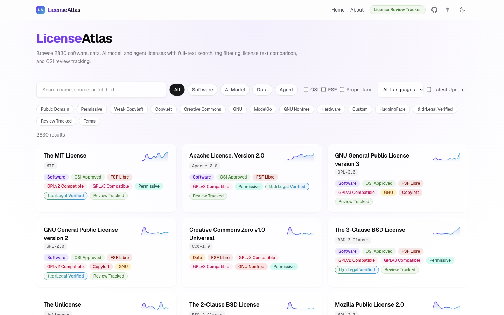
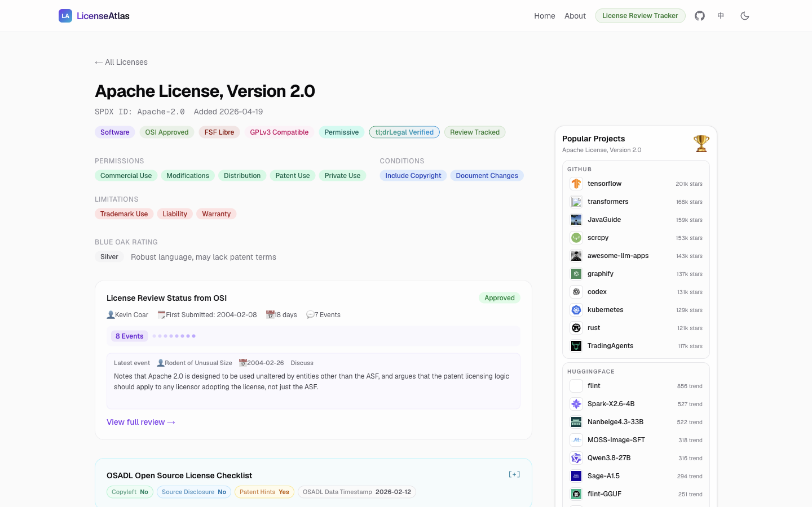
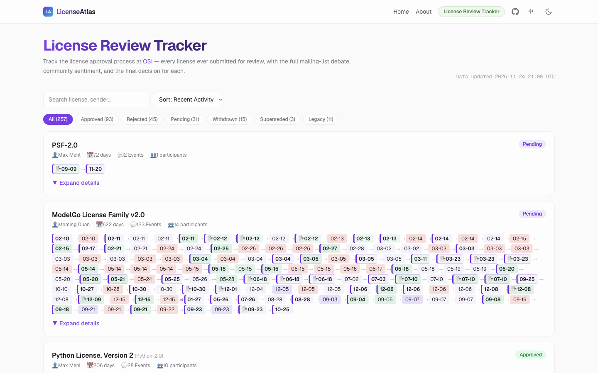

<div align="center">


# LicenseAtlas

Software, data, AI model, and agent license explorer

[](LICENSE)
[](https://morningd.github.io/license.atlas)
[](CONTRIBUTING.md)
[](https://nextjs.org)
[](https://www.typescriptlang.org)

**[Live site](https://morningd.github.io/license.atlas)** · **[Documentation](#documentation)** · **[Contributing](CONTRIBUTING.md)** · **[Report an issue](https://github.com/morningD/license.atlas/issues/new/choose)**

English | [简体中文](README.zh-CN.md)

</div>

<picture>
  <source media="(prefers-color-scheme: dark)" srcset="docs/images/home-dark.webp">
  
</picture>

LicenseAtlas is a software, data, AI model, and agent license explorer covering **2,830** licenses and terms, in English and Chinese. It puts the full text of each license next to what it lets you do, where it stands with OSI and FSF, how OSI's review of it went, and how widely it is used.

## Why

- **You are choosing a license for your own project.** Read the permissions, conditions, and limitations of the candidates, check whether OSI or FSF list them, and see how Blue Oak Council rates the wording.
- **You need to know what an AI model or dataset allows.** Custom HuggingFace licenses, RAIL, OpenAtom, OpenMDW, and others are collected together with the service terms they refer to.
- **You follow OSI license review.** The tracker covers every license submitted to OSI: the discussion, who took part, how the board voted, and how the text changed between submissions.
- **You want a first read on compliance.** OSADL checklists summarize obligations and prohibitions and give directional compatibility between licenses.

LicenseAtlas is a reference, not legal advice. See [Disclaimer](#disclaimer).

## Features

- **Full-text search** across license name, SPDX id, source, and body text, with fuzzy matching and exact or prefix SPDX and slug matches ranked first
- **Permissions, conditions, and limitations** for each license, plus OSI and FSF status and Blue Oak ratings
- **[OSI License Review Tracker](https://morningd.github.io/license.atlas/tracker)** — 281 submissions with discussion threads, timelines, participants, board votes, and submitted license-text history
- **License text comparison** — line-by-line diffs between the versions of a license submitted to OSI during its review
- **OSADL checklist signals** — obligations, prohibitions, copyleft and patent hints, and directional compatibility
- **Popularity and trends** — sparklines and rankings from HuggingFace, GitHub, and Kaggle
- **Popular Projects** — leading GitHub repositories, HuggingFace models, and Kaggle datasets for a license
- **Bilingual interface** in English and Chinese, with dark mode
- **Static site** — 2,830 pre-rendered license pages; search runs entirely in the browser

<table>
  <tr>
    <td width="50%"></td>
    <td width="50%"></td>
  </tr>
  <tr>
    <td align="center"><sub>License detail page</sub></td>
    <td align="center"><sub>OSI License Review Tracker</sub></td>
  </tr>
</table>

## Quick start

Use the live site at **[morningd.github.io/license.atlas](https://morningd.github.io/license.atlas)**. There is nothing to install.

To run it locally you need [Node.js](https://nodejs.org) 24 or later:

```bash
git clone https://github.com/morningD/license.atlas.git
cd license.atlas
npm install
npm run dev        # http://localhost:3000/license.atlas
```

| Command | Purpose |
|---|---|
| `npm run build` | Static export to `out/`; regenerates the search index first |
| `npm run lint` | ESLint |
| `npx tsc --noEmit` | Type check |

## Data sources and coverage

License texts and metadata are aggregated from:

| Source | Coverage |
|--------|----------|
| SPDX | 708 licenses |
| TLDRLegal | 145 licenses |
| OSI | 128 approved licenses |
| GNU / FSF | 66 licenses |
| Creative Commons | 38 licenses |
| choosealicense.com | 47 licenses |
| ScanCode LicenseDB | Custom license texts and metadata |
| Blue Oak Council | Permissive-license quality ratings |
| HuggingFace Hub | Custom model & dataset licenses |
| GitHub | Agent skill, MCP server, and tool licenses |
| Open Data Commons | 3 data licenses |
| RAIL | Responsible AI licenses |
| OpenAtom Foundation | Model and hardware licenses (bilingual CN/EN) |
| OpenMDW | Permissive license for ML models and related artifacts (Linux Foundation) |
| OSI Review Tracker | 281 OSI license-review submissions and discussion threads, timelines, first/decision dates, board-vote records, and locally archived submitted license texts from public review/discussion records |
| OSADL Open Source License Checklists | 124 checklist records, 123 matched LicenseAtlas pages, checklist-derived obligations/prohibitions, copyleft/source-disclosure/patent hints, and directional compatibility summaries |
| Project Showcase | 32 selected licenses with top GitHub repositories, HuggingFace models, and Kaggle datasets, normalized into a compact right-rail detail-page sidecar |

Popularity data comes from HuggingFace Hub (3.2M+ models), GitHub (28 license types), and Kaggle (714K+ datasets via Meta-Kaggle). The sparklines on license cards are monthly license trends extracted from the HuggingFace models parquet.

Data is refreshed by an incremental pipeline. Sources are re-crawled on freshness gates, newly discovered custom license candidates are reviewed before they are accepted, and unchanged outputs are not rewritten. The page footer shows the date of the latest license-corpus update.

## Documentation

| Document | What it covers |
|---|---|
| [Contributing guide](CONTRIBUTING.md) | Setting up locally, what to check before a pull request, how contributions are licensed |
| [Data Update Workflow](docs/data-update-workflow.md) | The full incremental update (`npm run update:data`) and the per-source commands: stages, incremental behavior, validation |
| [OSI License Review Tracker](docs/OSI-TRACKER.md) | Tracker data pipeline and data model: mail crawling, event types, vote-outcome inference (Chinese) |
| [Tracker integration architecture](docs/tracker-architecture.md) | How the tracker is integrated and kept up to date in LicenseAtlas: data flow, status adjudication, components (Chinese) |
| [OSADL Checklist Integration](docs/osadl-integration.md) | Scope, data flow, and sync of OSADL checklists |
| [Project Showcase Integration](docs/project-showcase-integration.md) | Selection, ranking, and incremental refresh of Popular Projects |

The data pipeline is maintained in a separate, private repository and feeds this one with data snapshots. The commands that drive it are for the maintainer; contributors do not need them.

## Contributing

Bug reports and pull requests are welcome.

- Something wrong with a license entry? Open an issue with the [License Feedback template](https://github.com/morningD/license.atlas/issues/new?template=license-feedback.yml).
- Want to change code or docs? Read [CONTRIBUTING.md](CONTRIBUTING.md) ([中文](CONTRIBUTING.zh-CN.md)).

The data files are generated by the pipeline, so data corrections go through issues rather than direct edits.

## License

Copyright (c) 2026 Moming Duan <duanmoming@gmail.com>.

The source code, scripts, documentation, and original content of this project are licensed under the [Mulan Permissive Software License, Version 2](LICENSE) (MulanPSL-2.0), an [OSI-approved](https://opensource.org/license/mulanpsl-2-0) open source license. The license is written in Chinese and English with equal legal effect; in case of divergence, the Chinese version prevails. It is also part of the LicenseAtlas corpus: [Mulan Permissive Software License v2](https://morningd.github.io/license.atlas/licenses/mulanpsl-2.0).

Contributions are licensed under MulanPSL-2.0 as well. See [License of your contributions](CONTRIBUTING.md#license-of-your-contributions).

Third-party license texts and metadata remain under their original copyrights and licenses:

- Submitted license texts in the OSI Review Tracker are reproduced from public OSI review and discussion records for research and review-tracking purposes; copyright remains with the original authors or license stewards.
- OSADL checklist data is attributed to Open Source Automation Development Lab (OSADL) eG and distributed by OSADL under CC-BY-4.0. It is shown as informational compliance metadata, not as legal advice.

## Disclaimer

LicenseAtlas provides license texts, review records, checklist data, compatibility signals, popularity data, and summaries for research, search, and general reference only. It does not provide legal advice or compliance advice. Rights and obligations should be determined from the original license text and official sources; for specific questions, consult a qualified legal professional.

LicenseAtlas makes reasonable efforts to cite public sources and keep source links, but does not warrant the completeness, accuracy, or timeliness of third-party data, extracted text, summaries, matches, or compatibility signals.

## Acknowledgements

LicenseAtlas stands on the work of the organizations that publish and maintain the license data it aggregates: SPDX, Open Source Initiative, GNU/FSF, Creative Commons, tl;drLegal, choosealicense.com, ScanCode LicenseDB, Blue Oak Council, OSADL, Open Data Commons, OpenAtom Foundation, OpenMDW, HuggingFace, GitHub, and Kaggle.

Built with [Next.js](https://nextjs.org), [Tailwind CSS](https://tailwindcss.com), and [MiniSearch](https://github.com/lucaong/minisearch).
