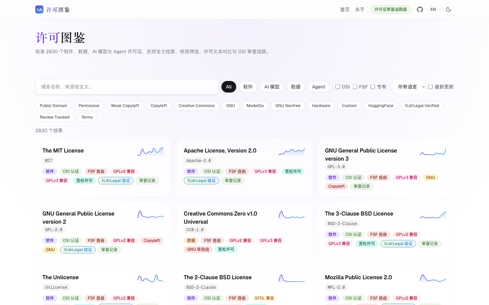
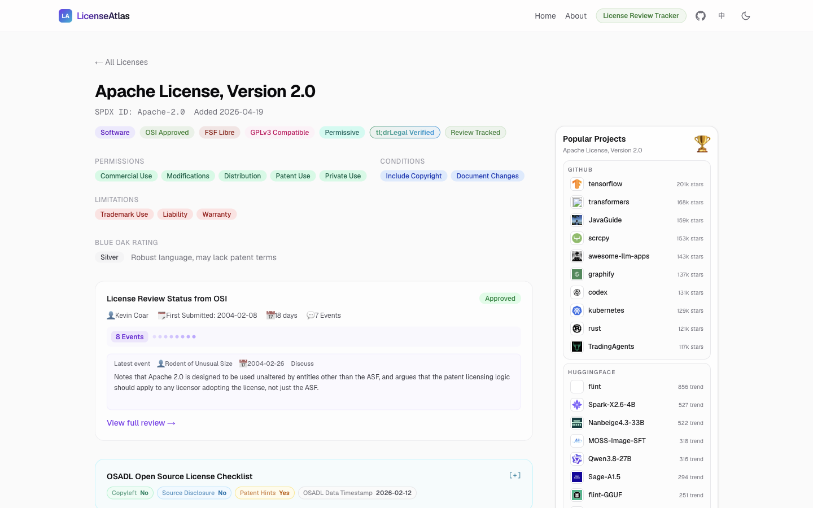
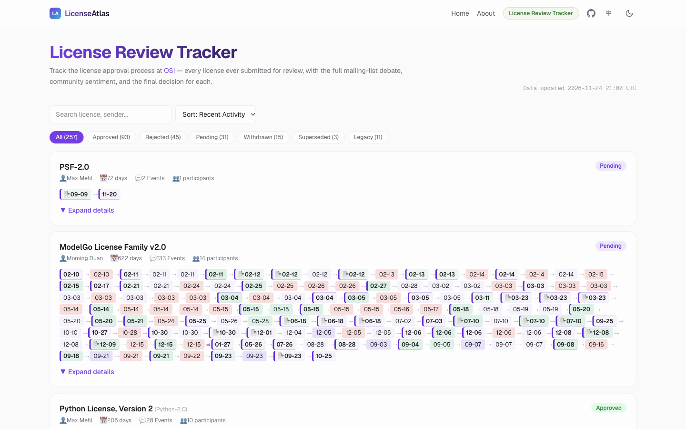

<div align="center">


# LicenseAtlas · 许可图鉴

面向软件、数据、AI 模型与 Agent 的许可证探索器

[](LICENSE)
[](https://morningd.github.io/license.atlas)
[](CONTRIBUTING.zh-CN.md)
[](https://nextjs.org)
[](https://www.typescriptlang.org)

**[在线访问](https://morningd.github.io/license.atlas)** · **[文档](#文档)** · **[参与贡献](CONTRIBUTING.zh-CN.md)** · **[反馈问题](https://github.com/morningD/license.atlas/issues/new/choose)**

[English](README.md) | 简体中文

</div>

<picture>
  <source media="(prefers-color-scheme: dark)" srcset="docs/images/home-zh-dark.webp">
  
</picture>

LicenseAtlas（许可图鉴）是面向软件、数据、AI 模型与 Agent 的许可证探索器，覆盖 **2,830** 个许可证和服务条款，提供中英文双语界面。每份许可证的全文都和它的关键信息放在一起：它允许你做什么、在 OSI 和 FSF 的认定情况、OSI 对它的审查经过，以及它的实际使用广度。

## 为什么需要它

- **为自己的项目选许可证。** 查看候选许可证的权限、条件和限制，确认 OSI 或 FSF 是否认可，并了解 Blue Oak Council 对条款措辞的评价。
- **想知道某个 AI 模型或数据集允许做什么。** HuggingFace 上的自定义许可证、RAIL、开放原子开源基金会、OpenMDW 等在此汇集，并与它们引用的服务条款关联。
- **跟踪 OSI 许可证审查。** 追踪器覆盖所有提交给 OSI 的许可证：讨论过程、参与者和董事会投票，以及文本在各次提交之间的变化。
- **想对合规性做初步了解。** OSADL 检查清单汇总了义务和禁止项，并给出许可证之间的方向性兼容关系。

LicenseAtlas 是参考工具，不构成法律意见。见[免责声明](#免责声明)。

## 功能

- **全文搜索**：覆盖许可证名称、SPDX ID、来源和正文，支持模糊匹配，SPDX 与 slug 的精确或前缀匹配排在最前
- **权限、条件与限制**：每个许可证都有，并附 OSI、FSF 认定状态和 Blue Oak 评级
- **[OSI 许可证审查追踪器](https://morningd.github.io/license.atlas/tracker)**：281 条提交，包含讨论线程、时间线、参与者、董事会投票，以及提交文本的历史版本
- **OSADL 检查清单信号**：义务、禁止项、Copyleft 与专利提示，以及方向性兼容性
- **热度与趋势**：来自 HuggingFace、GitHub 和 Kaggle 的趋势图与排名
- **明星项目**：使用某许可证的代表性 GitHub 仓库、HuggingFace 模型和 Kaggle 数据集
- **双语界面**：中英文切换，支持深色模式
- **静态站点** — 2,830 个预渲染许可证页面，搜索完全在浏览器中完成

<table>
  <tr>
    <td width="50%"></td>
    <td width="50%"></td>
  </tr>
  <tr>
    <td align="center"><sub>许可证详情页</sub></td>
    <td align="center"><sub>OSI 许可证审查追踪器</sub></td>
  </tr>
</table>

## 快速开始

直接访问 **[morningd.github.io/license.atlas](https://morningd.github.io/license.atlas)**，无需安装任何东西。

本地运行需要 [Node.js](https://nodejs.org) 24 或更高版本：

```bash
git clone https://github.com/morningD/license.atlas.git
cd license.atlas
npm install
npm run dev        # http://localhost:3000/license.atlas
```

| 命令 | 用途 |
|---|---|
| `npm run build` | 静态导出到 `out/`，会先重新生成搜索索引 |
| `npm run lint` | ESLint |
| `npx tsc --noEmit` | 类型检查 |

## 数据来源与覆盖

许可证原文和元数据聚合自：

| 来源 | 覆盖范围 |
|------|---------|
| SPDX | 708 个许可证 |
| TLDRLegal | 145 个许可证 |
| OSI | 128 个批准许可证 |
| GNU / FSF | 66 个许可证 |
| Creative Commons | 38 个许可证 |
| choosealicense.com | 47 个许可证 |
| ScanCode LicenseDB | 自定义许可证文本与元数据 |
| Blue Oak Council | 宽松许可证质量评级 |
| HuggingFace Hub | 自定义模型与数据集许可证 |
| GitHub | Agent 技能、MCP 服务器及工具许可证 |
| Open Data Commons | 3 个数据许可证 |
| RAIL | 负责任 AI 许可证 |
| 开放原子开源基金会 | 模型与硬件许可证（中英双语） |
| OpenMDW | AI 模型及关联制品的宽松开源许可证（Linux Foundation） |
| OSI 审查追踪器 | 281 条 OSI 许可证审查提交与讨论线程、时间线、首次提交与决议日期、董事会投票记录，以及来自公开审查与讨论记录的提交许可证文本存档 |
| OSADL 开源许可证检查清单 | 124 条检查清单记录，123 个匹配的 LicenseAtlas 页面，并提供由检查清单提取的义务与禁止项、Copyleft、源码披露、专利提示和方向性兼容性摘要 |
| 明星项目 | 32 个精选许可证的 GitHub 仓库、HuggingFace 模型与 Kaggle 数据集榜单，经标准化后作为详情页侧栏展示 |

热度数据来自 HuggingFace Hub（280 万+ 模型）、GitHub（28 种许可证类型）和 Kaggle（通过 Meta-Kaggle 覆盖 71.4 万+ 数据集）。许可证卡片上的趋势图来自 HuggingFace models parquet 提取的月度许可证趋势。

数据通过增量管线刷新：各数据源按新鲜度门控重新抓取，新发现的自定义许可证候选先经审核再收录，未变化的输出不会重写。页面页脚显示许可证语料的最新更新日期。

## 文档

| 文档 | 内容 |
|---|---|
| [贡献指南](CONTRIBUTING.zh-CN.md) | 本地环境搭建、提交 Pull Request 前的检查、贡献的许可方式 |
| [数据更新流程](docs/data-update-workflow.md) | 全量增量更新（`npm run update:data`）与单源命令：阶段、增量行为、验证（英文） |
| [OSI 许可证审查追踪器](docs/OSI-TRACKER.md) | 追踪器的数据管线与数据模型：邮件抓取、事件类型、投票结果推断 |
| [追踪器集成架构](docs/tracker-architecture.md) | 追踪器在 LicenseAtlas 中的集成与更新：数据流、状态裁决、组件 |
| [OSADL 检查清单集成](docs/osadl-integration.md) | OSADL 检查清单的范围、数据流与同步（英文） |
| [明星项目集成](docs/project-showcase-integration.md) | 明星项目的选择、排序与增量刷新（英文） |

数据管线在另一个私有仓库中维护，并向本仓库提供数据快照。驱动它的命令面向维护者，贡献者不需要使用。

## 参与贡献

欢迎提交 Issue 和 Pull Request。

- 某个许可证条目有误？使用 [License Feedback 模板](https://github.com/morningD/license.atlas/issues/new?template=license-feedback.yml)提交 Issue。
- 想修改代码或文档？请阅读[贡献指南](CONTRIBUTING.zh-CN.md)（[English](CONTRIBUTING.md)）。

数据文件由管线生成，所以数据更正请通过 Issue 提出，而不是直接修改。

## 许可证

Copyright (c) 2026 Moming Duan.

本项目的源代码、脚本、文档及原创内容采用[木兰宽松许可证，第2版](LICENSE)（MulanPSL-2.0）许可，这是一份经 [OSI 批准](https://opensource.org/license/mulanpsl-2-0)的开源许可证。许可证以中英文双语表述，具有同等法律效力；如有不一致，以中文版为准。它本身也收录在 LicenseAtlas 中：[Mulan Permissive Software License v2](https://morningd.github.io/license.atlas/licenses/mulanpsl-2.0)。

贡献同样采用 MulanPSL-2.0 许可，见[贡献的许可](CONTRIBUTING.zh-CN.md#贡献的许可)。

第三方许可证文本与元数据版权及许可归原权利人所有：

- OSI 审查追踪器中的提交许可证原文来自公开的 OSI 审查与讨论记录，仅用于研究和审查追踪；版权仍归原作者或许可证维护方所有。
- OSADL 检查清单数据归属 Open Source Automation Development Lab (OSADL) eG，由 OSADL 以 CC-BY-4.0 发布。LicenseAtlas 将其作为信息性合规元数据展示，不构成法律意见。

## 免责声明

LicenseAtlas 提供的许可证文本、审查记录、检查清单、兼容性信号、热度数据与摘要信息仅供研究、检索和一般参考，不构成法律意见或合规建议。许可证的权利义务应以原始许可证文本及其官方来源为准；具体的使用、分发、修改、合规或争议问题，请咨询具备资质的法律专业人士。

LicenseAtlas 会尽力引用公开来源并保留来源链接，但不保证第三方数据、自动提取结果、摘要、匹配关系或兼容性信号的完整性、准确性或时效性。

## 致谢

LicenseAtlas 建立在各组织发布并维护的许可证数据之上，感谢：SPDX、Open Source Initiative、GNU/FSF、Creative Commons、tl;drLegal、choosealicense.com、ScanCode LicenseDB、Blue Oak Council、OSADL、Open Data Commons、开放原子开源基金会、OpenMDW、HuggingFace、GitHub 和 Kaggle。

基于 [Next.js](https://nextjs.org)、[Tailwind CSS](https://tailwindcss.com) 和 [MiniSearch](https://github.com/lucaong/minisearch) 构建。
